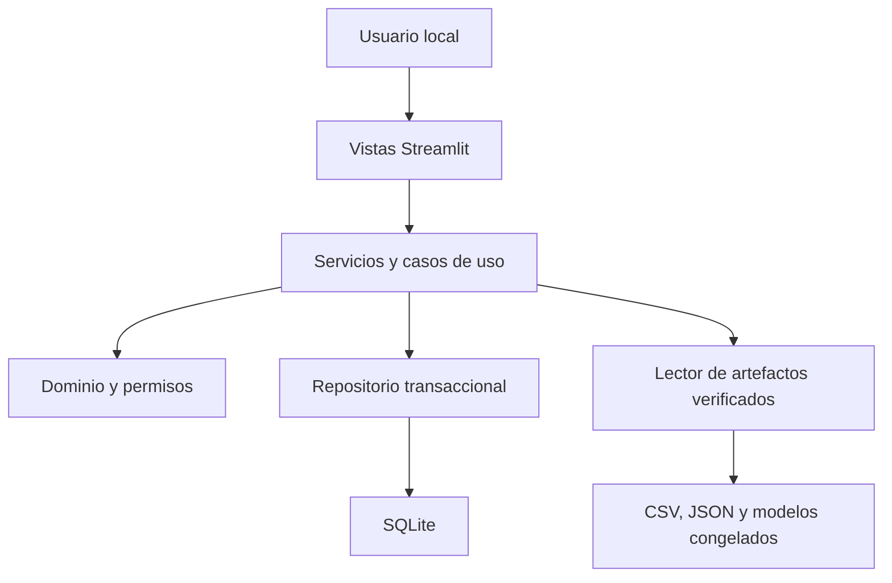

# Arquitectura

## Decisión

Monolito modular offline ejecutado en una laptop. Streamlit es la presentación; SQLite y artefactos CSV/JSON/Joblib son almacenamiento local. No hay microservicios, API pública, nube ni dependencia de proveedores de identidad. La autenticación TOTP se valida en el proceso local.

## Capas y MVC

| Capa | Implementación | Responsabilidad |
|---|---|---|
| Presentación/vista | `app.py`, `presentation/views.py`, charts | Formularios, navegación protegida, filtros y gráficos |
| Controlador | Coordinación de formularios en vistas y guards de app | Traducir eventos a llamadas de servicios, sin SQL ni reglas analíticas |
| Aplicación | AuthService, ReviewService, ReportService, BackupService, SettingsService | Casos de uso, autorización y coordinación |
| Dominio/modelo | Role, ReviewInput, estados, política de contraseña, permisos | Validaciones independientes de Streamlit/SQLite/Plotly |
| Analítica | FrozenReader | Lectura, hashes, relaciones, corte espacial, datos para gráficos |
| Infraestructura/repositorio | Store y tablas SQLAlchemy, LocalCipher, reporting | Transacciones, restricciones, cifrado y PDF |

El modelo persistente incluye usuarios, roles, sesiones, historial de contraseña, recuperaciones, episodios y revisiones. Mediciones, candidatos y calidad se leen como DTO/tablas congeladas; no se duplican innecesariamente en SQLite. La configuración de dependencias reside en `application/container.py`. La interfaz utiliza exclusivamente servicios; no contiene SQL.

## Integridad y consistencia

El manifiesto de Fase 7 fija los artefactos de Fases 4–6 y modelos de Fase 5. Verificación completa al cargar y por acción administrativa; cambios de tamaño/mtime durante uso provocan reverificación y rechazo. No se cargan binarios de procedencia arbitraria. El pipeline anterior realiza la comprobación de predicciones, separada de la app; la app no llama fit ni utiliza el evento documental como parámetro.

SQLite usa claves foráneas, índices, WAL y transacciones `BEGIN IMMEDIATE`, que serializan decisiones de seguridad entre procesos. Revisiones usan versión esperada para evitar sobrescrituras silenciosas. Roles y sesiones se comprueban de nuevo dentro de transacciones sensibles. El esquema está versionado como 1; un futuro cambio requiere migración explícita.

## Offline y alcance

El navegador se comunica por HTTP/WebSocket de loopback con Streamlit. Cero solicitudes externas en el recorrido de navegador bloqueando egress. Plotly, QR, estilos y fuentes se sirven localmente. Exportaciones y backups son bytes locales; el usuario decide dónde guardarlos. No se incluyen telemetría, mapas externos, APIs, SMS, correo, CDN o agentes generativos.

Las entidades no equivalen a diagnóstico geotécnico. Los resúmenes de episodio son retrospectivos y permanecen separados de los estados por registro.
